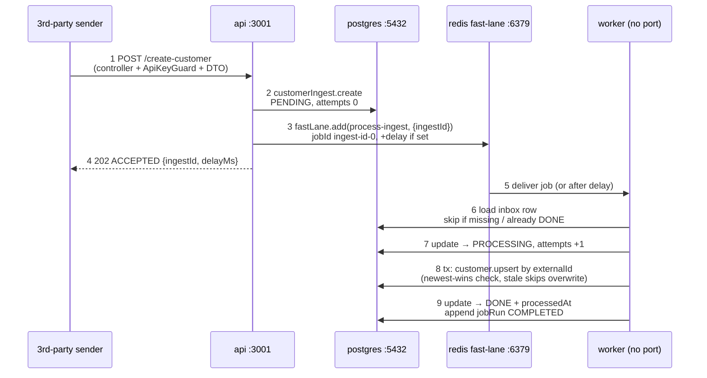

# Worker — where it runs and who calls it

Headless BullMQ consumer. No HTTP port, no browser URL — that is why
`pnpm dev` shows only dashboard (`3000`), API (`3001`), docs (`3002`),
yet hitting `POST /create-customer` still triggers worker log output.

## Where it runs

| Env | How | Evidence |
| --- | --- | --- |
| Local `pnpm dev` | 4th Turbo process alongside dashboard/api/docs (`turbo run dev`, `turbo.json`). `apps/worker/package.json#dev` compiles then runs `node dist/main.js`. | `apps/worker/src/main.ts` uses `createApplicationContext()`, never `app.listen()`; startup line `worker started lanes=...` |
| Prod (`infra/compose.prod.yaml`) | Own container `sim-worker`, no published ports, `WORKER_LANES=fast,cron`, shares `REDIS_HOST=redis-sim` with the API. | `infra/compose.prod.yaml:37-55` |

Entry: `apps/worker/src/main.ts` → `apps/worker/src/worker.module.ts`.
`WORKER_LANES` (default `fast,cron`) selects which processors register,
so the lanes can later split into two processes without code changes.

## Who calls it (nobody, over HTTP)

Nothing calls the worker. The coupling is two Redis queues
(`packages/shared/src/index.ts`):

| Queue | Jobs | Producer | Consumer |
| --- | --- | --- | --- |
| `customer-fast-lane` | `process-ingest` | API (`CustomersService.accept`) | `FastLaneProcessor` (concurrency 20) |
| `customer-cron` | `sweep-pending` (every 2 min), `aggregate-stats` (nightly 02:00) | worker itself (`SchedulerService.upsertJobScheduler`, idempotent) | `CronProcessor` (concurrency 1) |

- **API** (`apps/api/src/api.module.ts`) registers the queues as producer
  only — zero processors (stated in a code comment). `POST /create-customer`
  → `CustomersController` → `CustomersService.accept`
  (`apps/api/src/customers/customers.service.ts:32-59`): stores a
  `customerIngest` PENDING row first, then `fastLane.add(...)` with a 3s
  timeout. Redis down → still returns `202 ACCEPTED`; the row waits for
  the sweeper.
- **Dashboard** never touches the worker. It reads queue/inbox state via
  API admin endpoints; queue cards going "unavailable" means Redis is
  unreachable, not that the worker has an endpoint.
- **Docs app** is static, unrelated.
- **Worker calling itself:** `SchedulerService`
  (`apps/worker/src/scheduler.service.ts`) registers the cron schedules on
  boot; `CronProcessor.sweepPending` re-enqueues stuck rows (PENDING > 60s,
  FAILED < 10 attempts, stale PROCESSING) into the fast lane — the safety
  net when the immediate enqueue failed.

## The `POST /create-customer` path

Step → file → table:

| Step | File | Table write |
| --- | --- | --- |
| 1. Guard + validate | `apps/api/src/customers/customers.controller.ts`, `apps/api/src/auth/api-key.guard.ts` | — (401 before anything is stored) |
| 2. Store inbox PENDING | `apps/api/src/customers/customers.service.ts:34-36` | `CustomerIngest` create PENDING |
| 3. Enqueue | same file `:43-51` (3s race; Redis down → still accepted) | Redis `bull:customer-fast-lane:*` (job = `{ ingestId }` only) |
| 4. Return ACCEPTED | same file `:58` | — (request ends; sender never waits) |
| 5-6. Deliver + load | `apps/worker/src/fast-lane.processor.ts:25-35` | `CustomerIngest` read; idempotent skips |
| 7. Mark PROCESSING | same file `:37-40` | `CustomerIngest` → PROCESSING, attempts +1 |
| 8. Upsert truth | same file `:47-69` | `Customer` upsert by `externalId` |
| 9. Mark DONE + history | same file `:71-77`, `job-run.recorder.ts` | `CustomerIngest` → DONE; `JobRun` COMPLETED |

Failure branch: throw (e.g. `__FAIL__` name) → BullMQ retries ×3 with 2s exponential backoff (`FAST_LANE_JOB_OPTS`) → `onFailed` sets `CustomerIngest` → FAILED + `lastError` and appends a `JobRun` FAILED row (`fast-lane.processor.ts:81-95`). Recovery: cron `sweepPending` re-enqueues (`cron.processor.ts:47-72`) or manual Requeue from Ingests.

Same flow as SVG flowcharts 1-2 on the docs Architecture page
(`apps/docs/app/architecture/data.ts`: ACCEPT → PROCESS); this is the
markdown/mermaid mirror for repo readers. The processing detail (every
branch, exact queries, retry path) is already drawn there and intentionally
not duplicated.

## BullMQ wiring (fresh-NestJS reference)

`BullModule.forRoot` + `registerQueue` only open the Redis connection and hand out a queue handle. Movement needs a producer (`.add()`) and a consumer (`@Processor` + `process()`). This repo splits them: the API produces only, the worker consumes.

| Piece | Code |
| --- | --- |
| Create (connection + handle) | `packages/shared/src/index.ts` (names + `redisConnection()`); `apps/api/src/api.module.ts:12-14` (producer side); `apps/worker/src/worker.module.ts:22-32` (consumer side) |
| Push (`.add`) | `apps/api/src/customers/customers.service.ts:43-47` — `fastLane.add(PROCESS_INGEST, { ingestId }, ...)` on every create/update; `apps/worker/src/cron.processor.ts:63-68` — `addBulk` in `sweepPending`; `apps/worker/src/scheduler.service.ts:16-27` — `upsertJobScheduler` creating the two recurring cron jobs |
| Consume (`@Processor`) | `apps/worker/src/fast-lane.processor.ts:13-25`; `apps/worker/src/cron.processor.ts:28-44` |

Fresh NestJS checklist: `npm i @nestjs/bullmq bullmq`, `forRoot({ connection })` + `registerQueue({ name })` in the module, `InjectQueue(name)` + `.add(jobName, data, opts)` to push, a `@Processor(name)` class extending `WorkerHost` with `process(job)` to run. Split across processes? Both sides need `forRoot` + `registerQueue` against the same Redis.

Redis down stalls both lanes: the queues are Redis keys (`bull:customer-fast-lane:*`), so `.add()` buffers (hence the 3s race → still 202) and `process()` never fires. Accept-first in Postgres plus the 2-minute sweeper make this degraded-but-safe.

## Verify locally

- Turbo log shows `worker started lanes=fast,cron` (4th process, easy to miss
  next to the 3 dev-server banners).
- `POST /create-customer` → API logs `accepted <id>`, worker logs
  `jobId=... ingestId=... done`.
- Redis keys `bull:customer-fast-lane:*` hold the handoff; Postgres
  `customerIngest` rows show PENDING → PROCESSING → DONE.
